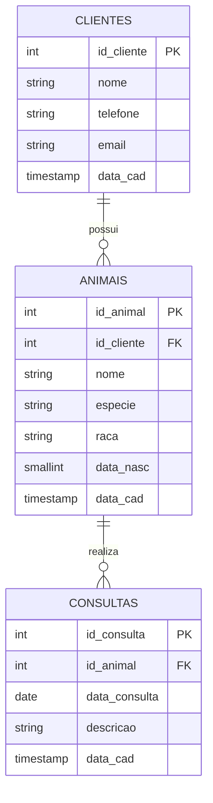

---
# Dicionario de Dados 
### Tabela: clientes

| Campo | Tipo de Dado | Nulo | Chave | Padrão | Descrição |
| --- | --- | --- | --- | --- | --- |
| id_cliente | SERIAL (INT) | Não | PK | Auto-incremento | Identificador único e sequencial do cliente. |
| nome | VARCHAR(100) | Não | - | - | Nome completo do cliente/dono. |
| telefone | VARCHAR(15) | Não | - | - | Número de telefone principal para contato. |
| email | VARCHAR(150) | Sim | - | NULL | Endereço de e-mail do cliente (opcional). |
| data_cad | TIMESTAMP | Não | - | CURRENT_TIMESTAMP | Data e hora em que o cliente foi cadastrado. |

### Tabela: animais

Armazena os dados dos animais vinculados a cada cliente.

| Campo | Tipo de Dado | Nulo | Chave | Padrão | Descrição |
| --- | --- | --- | --- | --- | --- |
| id_animal | SERIAL (INT) | Não | PK | Auto-incremento | Identificador único e sequencial do animal. |
| id_cliente | INT | Não | FK | - | Chave estrangeira que referencia clientes.id_cliente. |
| nome | VARCHAR(50) | Não | - | - | Nome do animal de estimação. |
| especie | VARCHAR(20) | Não | - | - | Espécie do animal (ex: Cachorro, Gato, Hamster). |
| raca | VARCHAR(30) | Sim | - | NULL | Raça do animal (opcional). |
| data_nasc | SMALLINT | Sim | - | NULL | Ano de nascimento (validado entre 1900 e 2100). |
| data_cad | TIMESTAMP | Não | - | CURRENT_TIMESTAMP | Data e hora de inclusão do registro. |

### Tabela: consultas

Registra o histórico de atendimentos clínicos realizados nos animais.

| Campo | Tipo de Dado | Nulo | Chave | Padrão | Descrição |
| --- | --- | --- | --- | --- | --- |
| id_consulta | SERIAL (INT) | Não | PK | Auto-incremento | Identificador único do atendimento clínico. |
| id_animal | INT | Não | FK | - | Chave estrangeira que referencia animais.id_animal. |
| data_consulta | DATE | Não | - | - | Data em que o atendimento/consulta foi realizado. |
| descricao | VARCHAR(250) | Não | - | - | Relatório resumido ou motivo da consulta. |
| data_cad | TIMESTAMP | Não | - | CURRENT_TIMESTAMP | Data e hora de criação da consulta no sistema. |